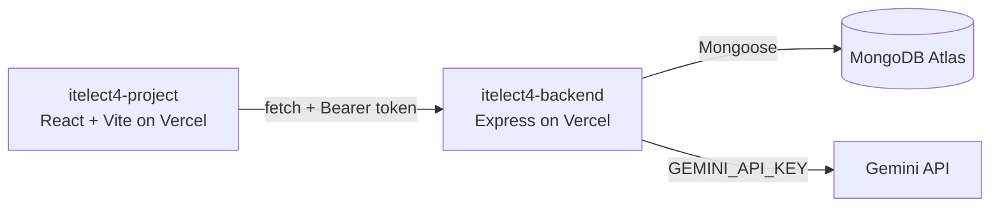

# itelect4-backend
 

 
The REST API behind the ITELECT4 class demo, end of Session 12: Express 5
in TypeScript, MongoDB Atlas through Mongoose, JWT login, and one route
that asks Gemini to review a project description.
 
- **Live API:** https://itelect4-backend-two.vercel.app/api/health
- **Frontend repo:** https://github.com/genemaynard25-arch/itelect4-project-IT4B
## Architecture
 

 
## Live Deployment
 
- **API base URL:** https://itelect4-backend-two.vercel.app
- **Health check:** https://itelect4-backend-two.vercel.app/api/health
  (returns `{"ok":true,"db":true}` when the database is connected)
- **Frontend:** https://itelect4-project-it4b.vercel.app
### Endpoints
 
| Method | Path | Access |
| --- | --- | --- |
| GET | `/api/health` | Public |
| POST | `/api/auth/register` | Public |
| POST | `/api/auth/login` | Public |
| GET | `/api/courses` | Public |
| GET | `/api/courses/:code` | Public |
| GET | `/api/submissions` | Requires token |
| POST | `/api/submissions` | Requires token |
 
### Environment variables
 
- `MONGODB_URI` - MongoDB Atlas connection string
- `JWT_SECRET` - secret used to sign login tokens
- `GEMINI_API_KEY` - API key for the Gemini review route
- `CORS_ORIGIN` - comma-separated allowed origins, e.g. `http://localhost:5173,https://itelect4-project-it4b.vercel.app`
